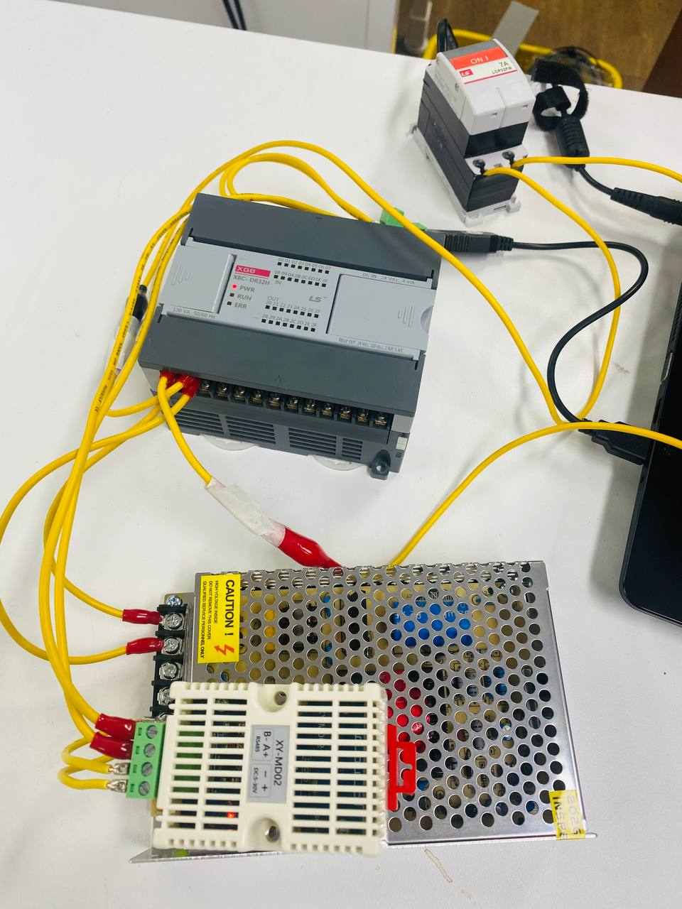
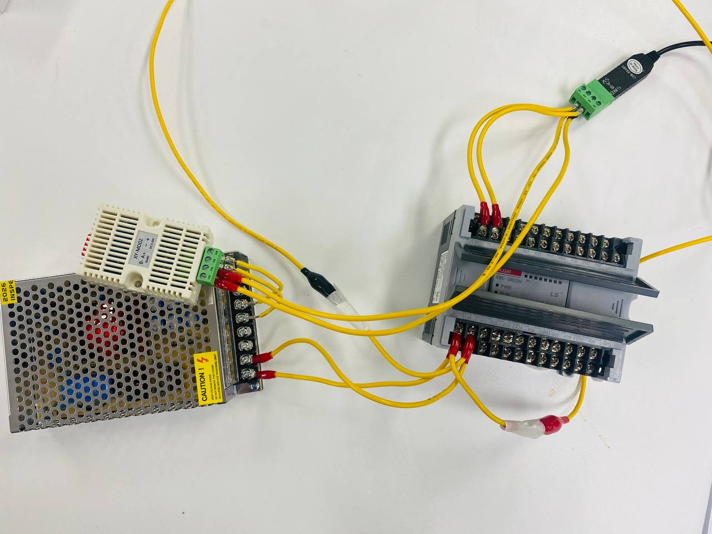
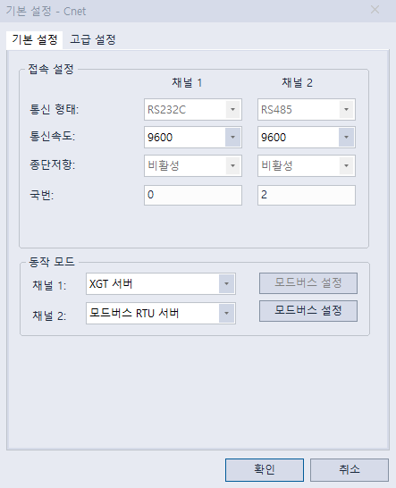
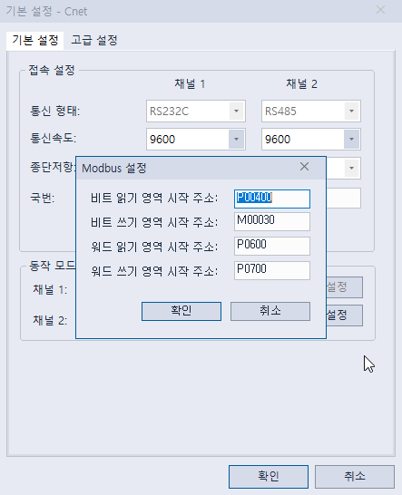

# Modbus PLC Study — RS-485 온습도 감지 토이 프로젝트



> 노트북과 PLC, 온습도 센서를 RS-485로 연결하여 입김 수준의 미세 온습도 변화를 감지하고 PLC에 전달하는 가벼운 테스트용 프로젝트입니다.

---

## 개요

이 프로젝트는 Python과 pymodbus 라이브러리를 사용하여 **XY-MD02 온습도 센서**에서 데이터를 읽고, **LS산전 XBC-DR32H PLC**의 M영역(코일)에 비트 단위로 전달하는 Modbus RTU 통신 실습입니다.

노트북이 두 개의 Modbus 슬레이브 장치와 통신합니다:

```
                    RS-485 (COM4, 9600bps)
  [노트북] ──── USB-RS485 변환 ────┬──── [XY-MD02 온습도 센서] (Slave ID 1)
                                  └──── [LS XBC-DR32H PLC]      (Slave ID 2)
```

### 동작 흐름

1. XY-MD02 센서에서 온도/습도 데이터 읽기 (Input Register, FC 04)
2. 최초 측정값을 기준점(baseline)으로 자동 보정
3. 기준점 대비 변화량을 8단계 비트 배열로 변환
4. PLC M영역(M30~M45)에 16개 코일 데이터로 전송 (FC 15)

### 감지 감도

| 데이터 | 단계(step) | 최대 감지 범위 | 비트 매핑 |
|--------|-----------|---------------|-----------|
| 온도 | 0.2℃ 단위 | +1.6℃ | M30~M37 (8비트) |
| 습도 | 3.0% 단위 | +24% | M38~M45 (8비트) |

> 입김을 불면 온도가 미세하게 상승하고 습도가 증가하여 PLC의 비트가 순차적으로 ON 되는 것을 확인할 수 있습니다.

---

## 사용 장비

| 장비 | 용도 | Modbus 설정 |
|------|------|------------|
| LS산전 XBC-DR32H | PLC (비트 출력) | Slave ID 2, 9600bps |
| XY-MD02 | 온습도 센서 | Slave ID 1, 9600bps |
| USB-RS485 변환기 | 통신 인터페이스 | COM4 |

---

## 배선 (Wiring)



RS-485 통신을 위해 USB-RS485 변환기의 A/B 단자를 PLC의 Cnet 모듈과 XY-MD02 센서의 A/B 단자에 병렬로 연결합니다.

---

## PLC 설정

### Cnet 통신 설정

XG5000 프로그램에서 Cnet 모듈의 통신 파라미터를 설정합니다.



- 통신 속도: 9600 bps
- 데이터 비트: 8, 패리티: None, 스톱비트: 1
- 통신 방식: Modbus RTU

### Modbus 설정

PLC가 Modbus 슬레이브로 동작하도록 설정합니다.



- 슬레이브 ID: 2
- 읽기/쓰기 가능 영역: 코일(M영역)

---

## 래더 로직

XG5000에서 작성한 간단한 래더 로직입니다. Python 스크립트가 M30~M45 코일에 쓴 비트를 읽어 출력 코일(Y영역)로 전달합니다.


---

## Modbus 통신 구성

### 센서 데이터 읽기 (XY-MD02 → 노트북)

| 항목 | 값 |
|------|-----|
| 함수 코드 | FC 04 (Read Input Registers) |
| 슬레이브 ID | 1 |
| 시작 주소 | 1 (온도), 2 (습도) |
| 데이터 형식 | 16비트 부호화, 실제값 × 10 |

온도 음수 처리: raw 값이 32768 이상이면 `(raw - 65536) / 10.0`으로 변환합니다.

### PLC 데이터 쓰기 (노트북 → PLC)

| 항목 | 값 |
|------|-----|
| 함수 코드 | FC 15 (Write Multiple Coils) |
| 슬레이브 ID | 2 |
| 시작 주소 | 0 (PLC M30) |
| 코일 수 | 16개 (온도 8 + 습도 8) |

---

## 설치 및 실행

### 요구 패키지

```
pymodbus[serial]==3.8.3
pyserial==3.5
```

### 설치

```bash
pip install -r requirements.txt
```

### 실행

```bash
python modbus_plc_xy-md02.py
```

> COM 포트 번호는 환경에 맞게 `PORT = "COM4"` 부분을 수정하세요.

---

## 실행 화면

프로그램을 실행하면 터미널에 온도/습도 수준이 이모지 바(🔥/💧)로 표시됩니다:

```
포트 연결 성공. 온습도 감지 루프를 시작합니다. (종료: Ctrl+C)
------------------------------------------------------------
✨ 초기 기준점 설정 완료 -> 기준 온도: 24.8℃, 기준 습도: 43.0%
[측정] 온도: 25.0℃ [🔥🔥  💧  ] | 습도: 44.0% [💧  ]
[측정] 온도: 25.3℃ [🔥🔥🔥  💧  ] | 습도: 46.0% [💧💧  ]
[측정] 온도: 26.1℃ [🔥🔥🔥🔥🔥🔥🔥  💧💧💧💧] | 습도: 55.0% [💧💧💧💧  ]
```

CLI의 온/습도 아이콘 개수 변화와 동일하게 PLC의 램프 16개가 변화됩니다.
 
8개의 온도, 8개의 습도 램프가 변화에 따라 움직입니다.

---

## 파일 구성

```
modbus-plc-study/
├── modbus_plc_xy-md02.py   # 메인 스크립트 (센서 읽기 → PLC 쓰기 루프)
└── requirements.txt        # 의존 패키지
```
---

## 라이선스

개인 학습용 토이 프로젝트입니다. 누구나 사용할 수 있습니다.